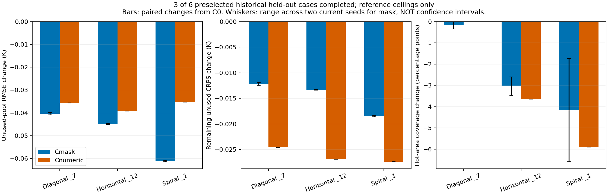

# Experiment 65: bounded mask generalization

## Question and status

Does the 256-location non-saturation-mask benefit survive beyond the two
development cases under source-on, all-readings-latent C? This is a controlled
validation of [Experiment 64](../64_full_latent_mask/README.md), not a new fit or
an expanded flag budget. The bounded run has stopped: **3 of 6 preselected
cases completed reliable three-arm comparisons**, one in each path family.
The other three are incomplete, not negative mask results. The 320 K posterior
control was not run because the predeclared reference reliability gate failed.

## Main results

Primary-seed, physical-area-weighted results in the fixed previously unused pool:

| Case | RMSE C0 / mask / numeric (K) | Mask RMSE reduction | CRPS C0 / mask / numeric (K) |
| --- | --- | --- | --- |
| Diagonal 7 | 0.238 / 0.197 / 0.202 | 17.2% | 0.197 / 0.189 / 0.161 |
| Horizontal 12 | 0.240 / 0.194 / 0.200 | 18.8% | 0.197 / 0.188 / 0.161 |
| Spiral 1 | 0.227 / 0.166 / 0.192 | 26.8% | 0.195 / 0.178 / 0.160 |

The paired second-seed mask reductions are 16.7%, 18.7%, and 26.9%, respectively.
At locations remaining unused by all arms (outside U), primary-seed RMSE falls
19.6%, 21.4%, and 27.3%; CRPS improves in all three. The effect is therefore not
limited to the 256 added locations. Between-repeat differences in unused-pool
RMSE gains are at most 0.00111 K, much smaller than the 0.040-0.061 K gains.

This is **limited cross-trajectory support**, not successful validation of all
six selected cases or a population-level claim. The numerical-reading control
has better unused-pool CRPS in all three cases, despite mask having lower RMSE.
It is also faster. Neither arm is a guaranteed error bound.

Unused-pool 95% coverage is already about 98.4-98.5% under C0 and rises to
98.7-98.9% with mask while intervals narrow slightly. This is not merely a gain
in sharpness with lost coverage, but higher coverage here should not be called
closer-to-nominal calibration: these intervals were already conservative.

**Hot-tail tradeoffs remain.** Horizontal 12 hot-area RMSE increases from 2.062
to 2.099 K, CRPS from 1.205 to 1.224 K, and coverage falls from 83.9% to 80.4%.
Both seeds show this deterioration. Spiral 1's hot CRPS change reverses sign
between repeats (-0.020 / +0.011 K); hot coverage falls in both repeats.
Diagonal 7's hot RMSE/CRPS improve slightly, with no robust coverage improvement.
All **15 completed fits still miss the true peak with their 95% interval**.
The Horizontal case underpredicts its peak; the two other cases overpredict it.

### Completion and numerical reliability

| Preselected case | Outcome |
| --- | --- |
| Diagonal 1 | Initial previous rank R-hat 1.01096 fails 1.01 gate; longer retry reaches 900 s predecessor-stage limit. |
| Diagonal 7 | All five current fits pass. |
| Horizontal 1 | Longer previous chains pass (R-hat 1.00392); subsequent prior construction exceeds combined 900 s stage limit. Not an MCMC convergence failure. |
| Horizontal 12 | Previous retry passes; all five current fits pass. |
| Spiral 1 | All five current fits pass. |
| Spiral 12 | Previous reflected HMC raises `Reflected HMC produced an infeasible draw`; stopped without current inference. |

Completed current fits: maximum rank R-hat 1.00566; minimum bulk/tail ESS
943.7/1074.4. Runtime ranges are C0 35.7-60.7 s, mask 154.6-276.8 s, numerical
55.8-62.0 s. Valid current fitting totals 26.1 minutes; maximum recorded current
RSS is 788.1 MiB. These are measured fit times, not end-to-end costs.
The full elapsed run including preparation, validation, stopped attempts and
an implementation correction was approximately 137 minutes.

An ordering bug in this **new driver** initially misaligned extended prior
columns with sorted likelihood IDs. It was fixed before any mask result was
accepted; the invalid attempts are retained and excluded from runtime/science
comparisons. The corrected development mask posterior and constrained draws
reproduce output 64 exactly. See [the correction record](implementation_correction.md).
Existing baselines, shared sampler and scientific settings were not changed.

**Decision:** preserve this promising but incomplete validation; do not expand
the flag budget or claim high-ceiling redundancy from these posterior results.
Resolving the stopped predecessor cases requires a separately specified
numerical/budget follow-up, not retuning source, noise or covariance here.

### Result files

- [Case status](case_status.csv), [primary unused-region table](primary_unused_region_table.csv)
- [All regional metrics](results.csv), [paired changes](paired_changes.csv), [repeat comparison](repeat_seed_comparisons.csv)
- [Current convergence/runtime](convergence_runtime.csv), [previous diagnostics](previous_convergence_runtime.csv)
- [Flag compatibility](flag_compatibility_summary.csv), [verification](verification.md)

## Prospective design

Before inspecting new outcomes, select the smallest and largest historical
held-out run index in each family, excluding the three development trajectories:
Diagonal 1/7, Horizontal 1/12, Spiral 1/12. These are historical held-out cases,
not pristine data never examined by earlier project experiments. This small,
deterministic selection is not a random population sample.

The only planned milder-ceiling control is Diagonal 1 at 320 K. It is gated on all six
reference cases passing reliability checks. No 325 K fits or flag-budget study.
The selection and configuration are frozen in
[prospective_selection.csv](prospective_selection.csv) and
[frozen_configuration.json](frozen_configuration.json).

- C0: retained current numerical observations and saturated inequalities only.
- Cmask: C0 plus noisy upper inequalities at 256 omitted locations.
- Cnumeric: C0 plus actual noisy readings at exactly those locations, without
  additional flag likelihoods.

For each trajectory, O_star is the fixed numerical-candidate set union the
observed reference saturation set. U is selected from its complement using the
unchanged deterministic physical-coordinate farthest-point rule. All U sets
are frozen before new held-out inference; Diagonal 1 reuses its U, unused pool,
and remaining-unused pool at 320 K. No selection uses errors or hidden truth.

## Frozen inference

The predecessor conditions on all numerical readings in the previous frame,
not all historical frames. Its full latent covariance includes the correlated
conditional residual and unsaturated-censored cross terms. Current priors use
Q_dt + A Sigma A.T, not only a diagonal approximation. Mean propagation retains
the inherited positive-excess floor, interpolation, cooling and boundary rules.
Only current information at U differs across the three arms of a given case.

Camera/previous likelihood SD remains 0.25 K; current likelihood SD is 0.50 K.
The source remains the empirical, thresholded, current FEM-derived vertical
gradient contribution. It is not independently specified laser heating.
All coefficients and kernel rules are inherited unchanged. Ambient and source
lengthscale retain the historical simulation-derived preparation rules; the
driver computes these without executing the old preparation's unused
diffusivity/coefficient regression. This is not camera-only deployment.

No newer predecessor caches exist for these held-out native cases. They are
therefore generated with the frozen output-60 protocol: four chains, initially
800 retained and 300 burn-in, one permitted 1600/600 retry. Each current fit uses
four chains, 800 retained, 300 burn-in, thinning 1, and 300 evaluation draws per
chain. C0/Cmask have two paired current seeds, Cnumeric one. No current retries.

Each fit must satisfy rank-normalized split R-hat <=1.01, classical R-hat <=1.05,
bulk/tail ESS >=400, runtime <=900 s and peak RSS <=4096 MiB. A failed case is
stopped and reported, never replaced by another trajectory. Before held-out
inference, an independent reconstruction of Diagonal 8 checks cameras, U,
previous chains and predictive prior against the completed development run.

## Evaluation and boundaries

Primary: area-weighted RMSE/CRPS in the fixed unused pool, plus the common
remaining-unused locations outside U. Also retain added-U, censored, hot-1%-area,
whole-field and true-peak metrics, coverage and interval width. Report paired
seed differences and per-case/family results; spatial pixels are not independent
experimental replicates. A small or negative effect remains a valid result.

Baseline flag compatibility is measured only after selection, for interpretation
and not tuning. The numerical control is neither an oracle nor a guaranteed
error bound. Marginal current prediction draws are not joint-field samples.
The inherited M(M-1) CRPS convention is preserved, but its formal unbiasedness
assumes independent draws, unlike these MCMC samples.

Driver: [69_thermal_mask_generalization.py](../../../scripts/69_thermal_mask_generalization.py).
Historical experiments and baselines remain unchanged.
